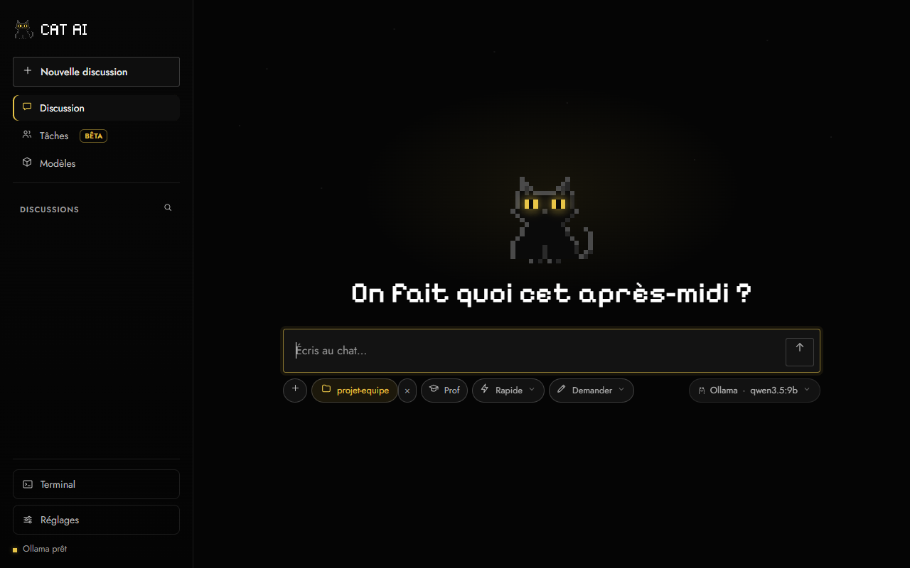
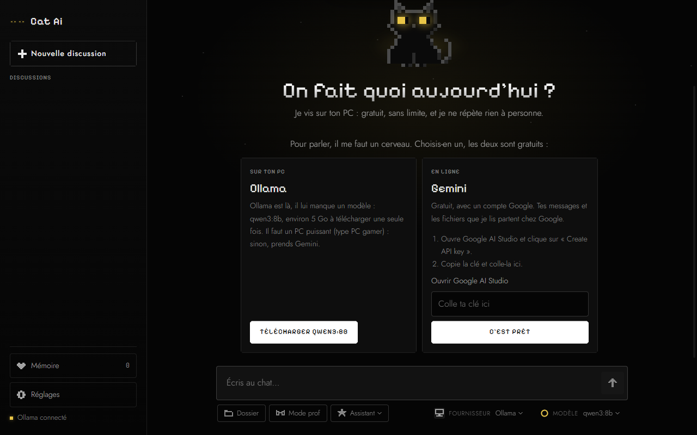
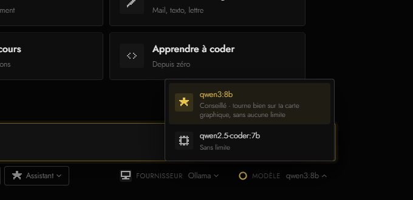

# Cat Ai

[Français](README.md)

A pixel-art black cat that lives on your PC and helps with everything: explaining a topic, writing a message, studying, learning to code. It can also read your code and change it, always after you agree. The app speaks French.

**100% free**: it runs with [Ollama](https://ollama.com) on your PC, or with the free tier of Gemini, Groq or OpenRouter. Paid models can't be used.

## Install

Download the file for your system from the [latest release](https://github.com/tom-legros/Cat.ai/releases/latest):

- **Windows**: `Cat-Ai-x.y.z-installateur.exe`, then double-click it. The app isn't signed yet: if Windows says "Windows protected your PC", click **More info**, then **Run anyway**. No admin rights needed.
- **Linux**: `Cat-Ai-x.y.z.AppImage`. Put it in a folder where it will stay (for example `~/Applications`), then `chmod +x Cat-Ai-*.AppImage` and run it (on Arch you may need `fuse2`). On first launch, Cat Ai offers to add itself to your applications menu.

Updates come on their own: the app tells you and installs them in one click.

## First launch

The cat asks for your first name, then offers two free ways to make it talk:

| | Ollama | Gemini |
| --- | --- | --- |
| For | Powerful PCs (like a recent gaming PC) | Everyone, even a small PC |
| How | "Télécharger" (5 GB, once) | Paste a [free key](https://aistudio.google.com/apikey) |
| Your data | Stays on your PC | Goes to Google |

## What it can do

- **Explain, write, study**: lessons, messages, quizzes, and a **teacher mode** that helps you find the answer yourself.
- **Read your project**: open a folder and it answers from the real code.
- **Edit files**: every change is shown before / after and waits for your approval.
- **Search the web**: it reads the docs (ArchWiki, manuals…) and gives its sources.
- **Remember**: it keeps what you tell it, and you can edit everything.
- **In the terminal**: the `catai` command, the same cat without a window.
- **Background tasks** *(experimental)*: it works on your project while you do something else. Turn it on in Réglages › Apparence › Fonctions expérimentales.

## Your data

API keys are encrypted by your system, a `.env` file or a private key is never read without your approval, and the cat stays inside the open folder. The only thing the app does on its own online: ask GitHub whether a new version exists.

## For developers

Run from source, tests, installers: [docs/developpement.md](docs/developpement.md) (in French).

## Credits

[Electron](https://github.com/electron/electron), [marked](https://github.com/markedjs/marked), [DOMPurify](https://github.com/cure53/DOMPurify), [highlight.js](https://github.com/highlightjs/highlight.js), [jsdiff](https://github.com/kpdecker/jsdiff), [Ollama](https://github.com/ollama/ollama) and the [Qwen](https://github.com/QwenLM/Qwen3) models. Fonts (SIL OFL): [Pixelify Sans](https://github.com/eifetx/Pixelify-Sans), [Jost](https://github.com/indestructible-type/Jost), [Marcellus](https://fonts.google.com/specimen/Marcellus), [JetBrains Mono](https://github.com/JetBrains/JetBrainsMono). The black cat comes from my portfolio; the app is built with help from Claude (Anthropic).

## License

[MIT](LICENSE)
