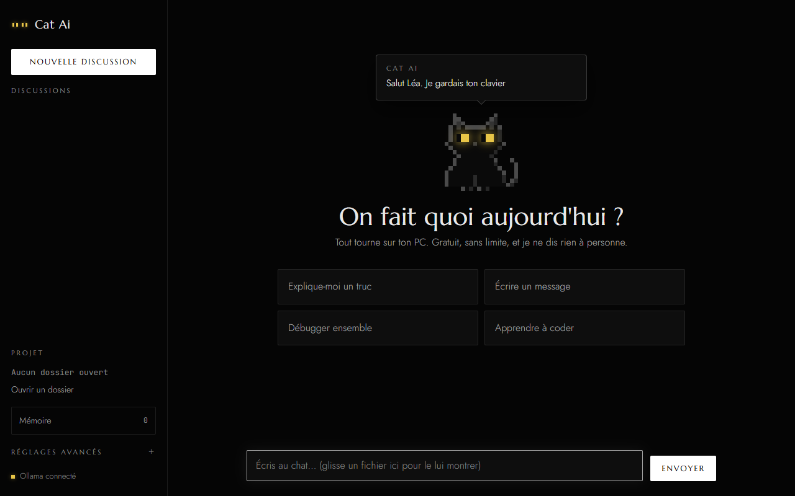
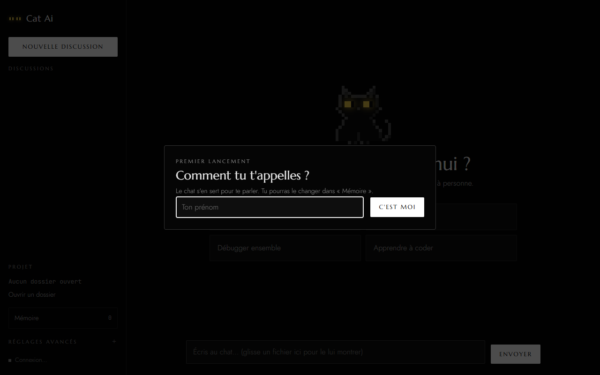
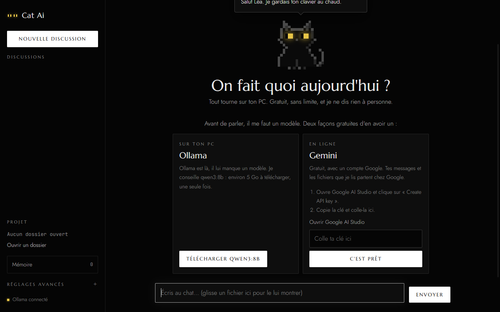
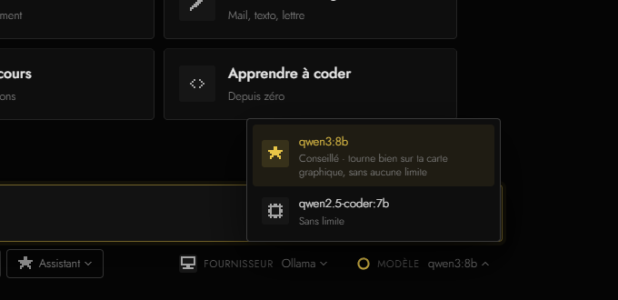
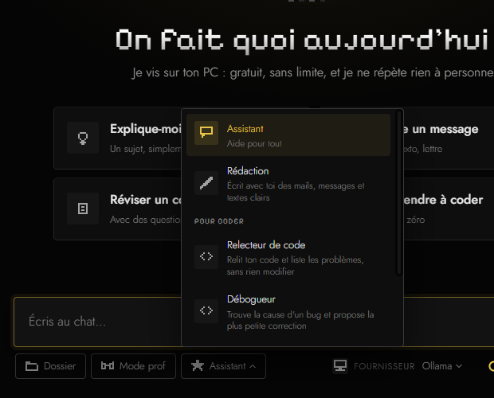
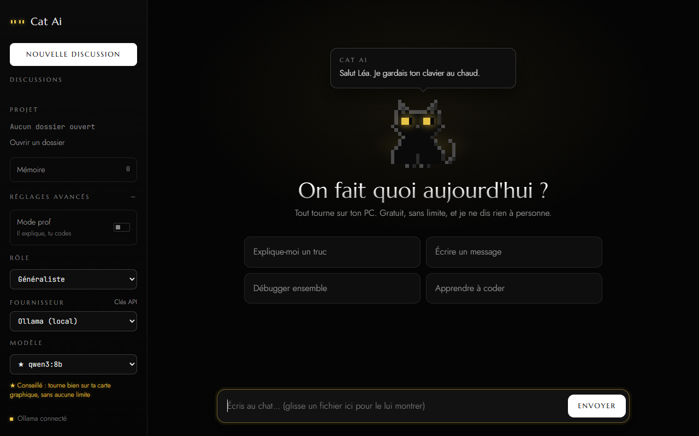

# Cat Ai

Un chat noir en pixel art qui vit sur ton PC et t'aide pour tout : expliquer un sujet, écrire un message, réviser, apprendre à coder. Il sait aussi lire ton code et le modifier, toujours après ton accord.

**100 % gratuit** : il tourne avec [Ollama](https://ollama.com) sur ton PC, ou avec l'offre gratuite d'un fournisseur en ligne (Gemini, Groq, OpenRouter). Aucun modèle payant ne peut être utilisé.



## Tuto : prêt en 3 étapes

### 1. Télécharger

Va dans les [Releases](https://github.com/tom-legros/Cat.ai/releases/latest) et prends le fichier de ton système :

- **Windows** : `Cat-Ai-1.1.0-installateur.exe`
- **Linux** : `Cat-Ai-1.1.0.AppImage`

### 2. Installer

- **Windows** : double-clique sur l'installateur. L'app n'est pas signée (un certificat coûte cher), donc Windows affiche « Windows a protégé votre ordinateur » : clique sur **Informations complémentaires**, puis **Exécuter quand même**. Pas besoin d'être administrateur.
  - **« Le Contrôle intelligent des applications a bloqué… »** : c'est une protection plus stricte de Windows 11, qui bloque toute app non signée, sans bouton pour passer outre. L'app n'est pas dangereuse, Windows ne la connaît juste pas encore. L'app n'est pas encore signée, donc pour l'instant la seule solution est de désactiver cette protection dans Sécurité Windows → Contrôle des applications et du navigateur → Paramètres du Contrôle intelligent des applications. C'est une protection de ton PC : ne la coupe que si tu es à l'aise avec ça, et sache que selon ta version de Windows tu ne pourras peut-être pas la réactiver sans réinitialiser Windows.
- **Linux** : `chmod +x Cat-Ai-1.1.0.AppImage && ./Cat-Ai-1.1.0.AppImage` (sur Arch, il peut falloir `fuse2`). Range d'abord le fichier dans un dossier où il restera (par exemple `~/Applications`) : au premier lancement, Cat Ai propose de s'ajouter au **menu des applications**, avec son icône, comme une app installée.

### 3. Premier lancement

Le chat te demande ton prénom :



Puis il te propose deux façons gratuites de le faire parler :



| | Ollama | Gemini |
| --- | --- | --- |
| Pour qui | Les PC puissants (type PC gamer récent). Sur un PC portable classique, il sera très lent | Tout le monde, même sur un petit PC |
| Comment | Clique sur « Télécharger » (5 Go, une seule fois) | Crée une [clé gratuite](https://aistudio.google.com/apikey), colle-la, « C'est prêt » |
| Tes données | Ne sortent pas de ton PC | Partent chez Google |

C'est tout : pose ta question en bas, ou clique sur une suggestion.

## Sous la barre de saisie

Tout se règle d'un clic, sans fouiller dans les menus :

- **Dossier** : ouvre un dossier pour que le chat lise son contenu.
- **Mode prof** : il t'aide à trouver par toi-même, sans donner la réponse.
- **Rôle** : la mission du chat (Assistant, Rédaction, ou ceux pour coder). « Créer un rôle » pour inventer le tien : Coach de révisions, Cuisinier… Tu peux aussi le partager avec un ami : « Partager » crée un petit fichier `.catai`, qu'il ajoute avec « Importer un rôle reçu ». Et le **Marché des rôles** (dans le même menu) propose des rôles prêts à l'emploi : Correcteur d'orthographe, Coach de révisions, Prof d'anglais, Cuisinier étudiant…
- **Fournisseur** et **Modèle** : qui fait réfléchir le chat, et quelle version. Chaque choix a un petit conseil, et le rond montre ce qu'il reste du quota gratuit du jour.





Les clés gratuites (Gemini, Groq, OpenRouter) se collent dans **Réglages**, en bas à gauche, avec un lien « Obtenir une clé » pour chacune.



## Ce qu'il sait faire

- **Lire ton projet** : il ouvre un dossier, lit et cherche dans le code, et répond à partir du vrai code.
- **Chercher sur internet** : pour une doc (Linux, une commande, une erreur…) ou une info récente, il cherche, lit les meilleures pages (ArchWiki, manuels, doc officielle…) et te répond avec leurs liens. Tu peux aussi lui donner un lien à lire ou à résumer. La recherche passe par DuckDuckGo, gratuit et sans compte : seuls les mots cherchés y partent.
- **Modifier des fichiers** : chaque modification s'affiche avant / après, et rien n'est écrit sans ton accord.
- **Longues tâches** : le chat enchaîne jusqu'à 30 actions par message sans te demander de continuer, et ne refait jamais trois fois la même. Les modifications de fichiers te sont toujours montrées avant.
- **Pour tout le monde** : il explique, aide à écrire, fait réviser, apprend à coder depuis zéro.
- **Mode prof** : il explique et pose des questions, mais c'est toi qui trouves.
- **Rôles** : Rédaction, ceux pour coder (relecteur, débogueur, README), les tiens, à partager avec tes amis, et ceux du marché des rôles. Un bon rôle ? « Proposer » ouvre une demande sur GitHub, relue avant d'arriver au marché.
- **Un vrai chat** : il cligne des yeux, suit ta souris, s'endort quand tu ne fais rien et a toujours une réplique selon l'heure.
- **Mémoire** : il retient ce que tu lui dis d'une discussion à l'autre, et tu peux tout modifier.
- **Mises à jour** : quand une nouvelle version sort, l'app te le dit en bas à gauche et l'installe en un clic (installateur Windows et AppImage). Rien ne se télécharge sans ton accord.
- **Sécurité** : un `.env` ou une clé privée n'est jamais lu sans ton accord, les clés API sont chiffrées par le système, et le chat ne sort jamais du dossier ouvert. Il ne lit que des pages internet publiques, jamais celles de ton PC ou de ton réseau (box, imprimante…). La seule chose que l'app fait seule sur internet, c'est demander à GitHub, au démarrage, s'il existe une nouvelle version : rien sur toi n'est envoyé.

## Lancer depuis le code

Il faut [Node.js](https://nodejs.org).

```bash
npm install
npm start
```

| Commande | Rôle |
| --- | --- |
| `npm test` | Lance les tests (`node --test`, sans Electron) |
| `npm run installateur` | Crée l'installateur Windows dans `dist/` |
| `npm run installateur:linux` | Crée l'AppImage (à lancer depuis Linux ou WSL) |

Pour publier une version, joins à la release les installateurs **et** `latest.yml`, `latest-linux.yml` et `Cat-Ai-x.y.z-installateur.exe.blockmap` (tous dans `dist/`) : c'est ce que lit la mise à jour automatique.

Le marché des rôles est le fichier [`marche/roles.json`](marche/roles.json) : pour ajouter un rôle proposé, ajoute-le à la liste (nom, description, auteur, consigne), lance `npm test` (il vérifie le fichier), puis pousse sur `main`. Les apps le lisent directement sur GitHub, sans nouvelle version. Avec `npm start`, c'est le fichier local qui est lu.

Le code est séparé en deux : `main.js` et `principal/` pour le processus principal (fichiers, modèles, garde-fous), `renderer.js` et `interface/` pour la fenêtre. Les données (discussions, mémoire, clés chiffrées) sont dans `%APPDATA%\assistant-ia` sur Windows et `~/.config/assistant-ia` sur Linux.

## Crédits

- [Electron](https://github.com/electron/electron), [marked](https://github.com/markedjs/marked), [DOMPurify](https://github.com/cure53/DOMPurify), [highlight.js](https://github.com/highlightjs/highlight.js) et [jsdiff](https://github.com/kpdecker/jsdiff).
- [Ollama](https://github.com/ollama/ollama) et les modèles [Qwen](https://github.com/QwenLM/Qwen3) (Apache-2.0).
- Polices sous SIL Open Font License : [Pixelify Sans](https://github.com/eifetx/Pixelify-Sans), [Jost](https://github.com/indestructible-type/Jost), [Marcellus](https://fonts.google.com/specimen/Marcellus), [JetBrains Mono](https://github.com/JetBrains/JetBrainsMono).
- Le chat noir et sa DA viennent de mon portfolio. Application développée avec l'aide de Claude (Anthropic) via Claude Code.

## Licence

[MIT](LICENSE)
