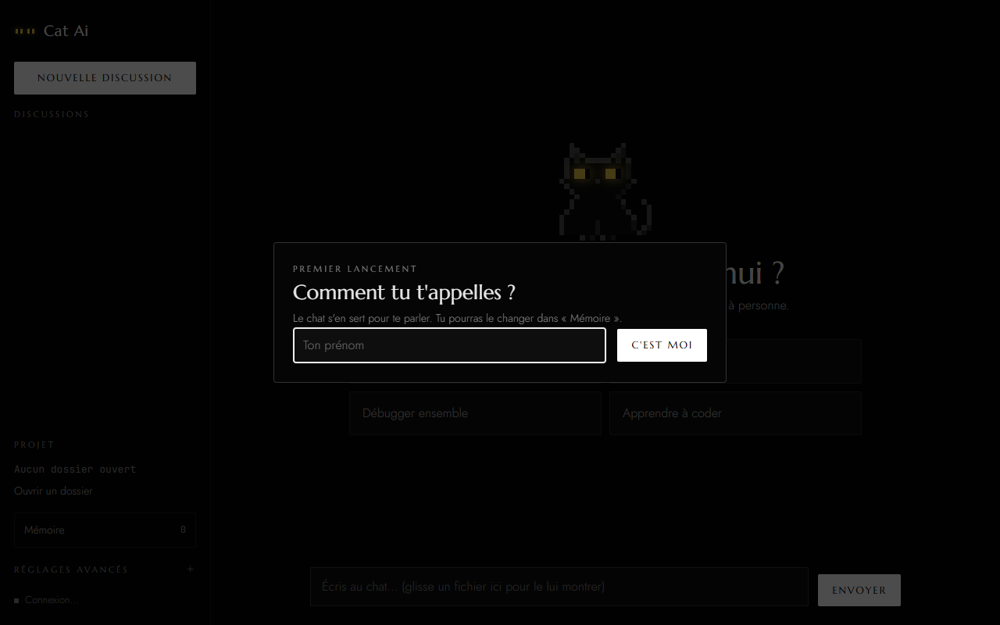
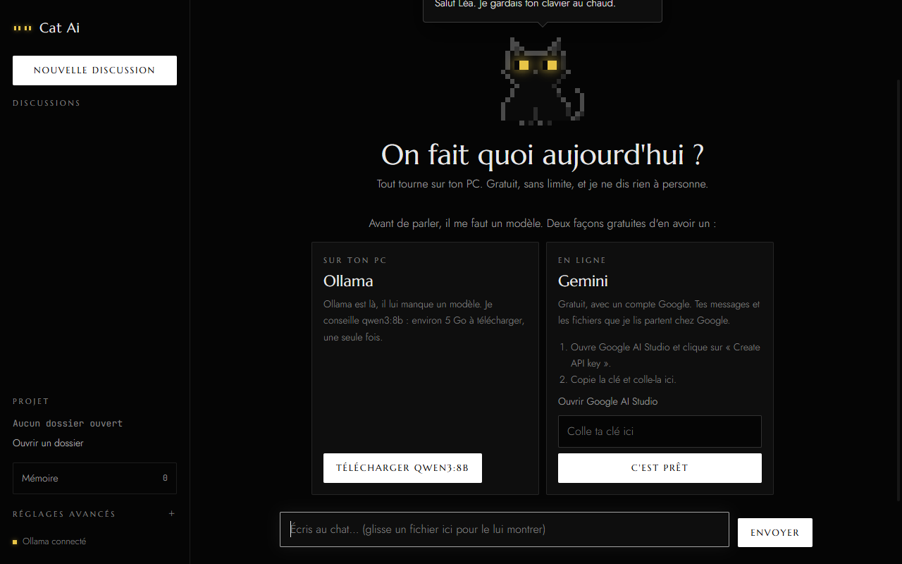
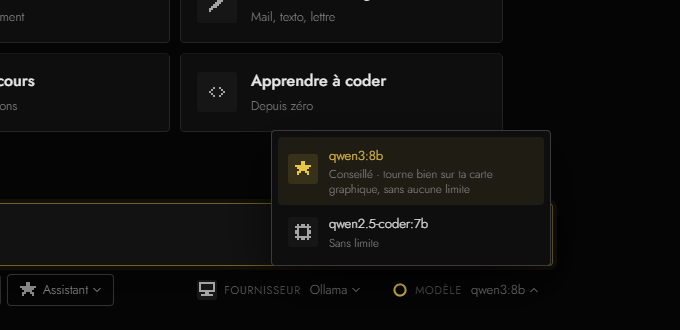
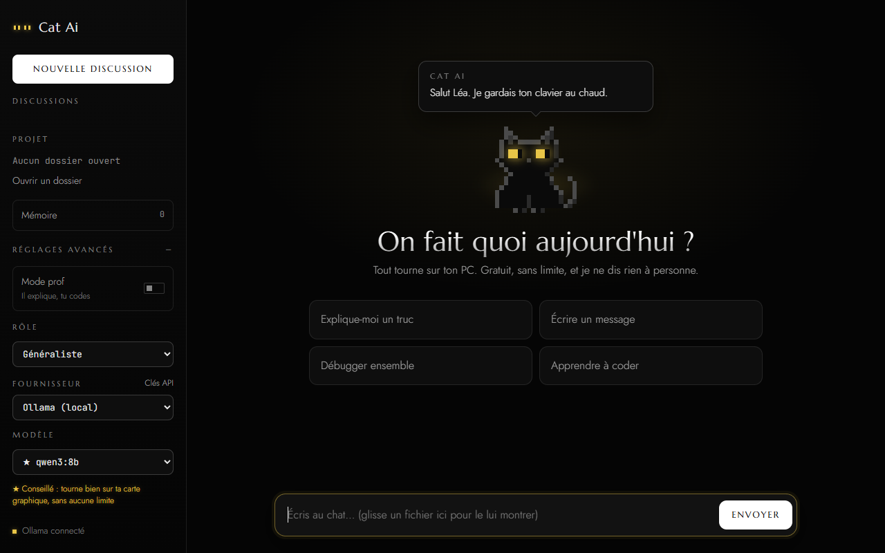

# Cat Ai

Un chat noir en pixel art qui vit sur ton PC et t'aide pour tout : expliquer un sujet, écrire un message, réviser, apprendre à coder. Il sait aussi lire ton code et le modifier, toujours après ton accord.

**100 % gratuit** : il tourne avec [Ollama](https://ollama.com) sur ton PC, ou avec l'offre gratuite d'un fournisseur en ligne (Gemini, Groq, OpenRouter). Aucun modèle payant ne peut être utilisé.


## Tuto : prêt en 3 étapes

### 1. Télécharger

Va dans les [Releases](https://github.com/tom-legros/Cat.ai/releases/latest) et prends le fichier de ton système :

- **Windows** : `Cat-Ai-2.0.0-installateur.exe`
- **Linux** : `Cat-Ai-2.0.0.AppImage`

### 2. Installer

- **Windows** : double-clique sur l'installateur. L'app n'est pas signée (un certificat coûte cher), donc Windows affiche « Windows a protégé votre ordinateur » : clique sur **Informations complémentaires**, puis **Exécuter quand même**. Pas besoin d'être administrateur.
  - **« Le Contrôle intelligent des applications a bloqué… »** : c'est une protection plus stricte de Windows 11, qui bloque toute app non signée, sans bouton pour passer outre. L'app n'est pas dangereuse, Windows ne la connaît juste pas encore. L'app n'est pas encore signée, donc pour l'instant la seule solution est de désactiver cette protection dans Sécurité Windows → Contrôle des applications et du navigateur → Paramètres du Contrôle intelligent des applications. C'est une protection de ton PC : ne la coupe que si tu es à l'aise avec ça, et sache que selon ta version de Windows tu ne pourras peut-être pas la réactiver sans réinitialiser Windows.
- **Linux** : `chmod +x Cat-Ai-2.0.0.AppImage && ./Cat-Ai-2.0.0.AppImage` (sur Arch, il peut falloir `fuse2`). Range d'abord le fichier dans un dossier où il restera (par exemple `~/Applications`) : au premier lancement, Cat Ai propose de s'ajouter au **menu des applications**, avec son icône, comme une app installée.

### 3. Premier lancement

Le chat te demande ton prénom :



Puis il te propose deux façons gratuites de le faire parler :



| | Ollama | Gemini |
| --- | --- | --- |
| Pour qui | Les PC puissants (type PC gamer récent). Sur un PC portable classique, il sera très lent | Tout le monde, même sur un petit PC |
| Comment | Clique sur « Télécharger » (5 Go, une seule fois) | Crée une [clé gratuite](https://aistudio.google.com/apikey), colle-la, « C'est prêt » |
| Tes données | Ne sortent pas de ton PC | Partent chez Google |

C'est tout : pose ta question en bas, ou clique sur une suggestion.

## Sous la barre de saisie

Tout se règle d'un clic, sans fouiller dans les menus :

- **Dossier** : ouvre un dossier pour que le chat lise son contenu.
- **Mode prof** : il t'aide à trouver par toi-même, sans donner la réponse.
- **Fournisseur** et **Modèle** : qui fait réfléchir le chat, et quelle version. Chaque choix a un petit conseil, et le rond montre ce qu'il reste du quota gratuit du jour.



Les clés gratuites (Gemini, Groq, OpenRouter) se collent dans **Réglages**, en bas à gauche, avec un lien « Obtenir une clé » pour chacune.



## Ce qu'il sait faire

- **Lire ton projet** : il ouvre un dossier, lit et cherche dans le code, et répond à partir du vrai code.
- **Chercher sur internet** : pour une doc (Linux, une commande, une erreur…) ou une info récente, il cherche, lit les meilleures pages (ArchWiki, manuels, doc officielle…) et te répond avec leurs liens. Tu peux aussi lui donner un lien à lire ou à résumer. La recherche passe par DuckDuckGo, gratuit et sans compte : seuls les mots cherchés y partent.
- **Modifier des fichiers** : chaque modification s'affiche avant / après, et rien n'est écrit sans ton accord.
- **Tâches de fond** : donne-lui un travail sur ton projet (`/agent corrige le bug du menu`), va faire autre chose, et reviens voir le résultat dans la page **Tâches**. Il travaille dans une copie de ton projet : tu regardes ce qu'il a changé, puis tu gardes ou tu jettes. Pour un gros travail, `/chantier` le confie à une équipe (un chef qui découpe, des codeurs, un relecteur). Le chat peut aussi te proposer lui-même de lancer une tâche.
- **Longues tâches** : le chat enchaîne jusqu'à 30 actions par message sans te demander de continuer, et ne refait jamais trois fois la même. Les modifications de fichiers te sont toujours montrées avant.
- **Pour tout le monde** : il explique, aide à écrire, fait réviser, apprend à coder depuis zéro.
- **Mode prof** : il explique et pose des questions, mais c'est toi qui trouves.
- **Un vrai chat** : il cligne des yeux, suit ta souris, s'endort quand tu ne fais rien et a toujours une réplique selon l'heure.
- **Mémoire** : il retient ce que tu lui dis d'une discussion à l'autre, et tu peux tout modifier.
- **Mises à jour** : quand une nouvelle version sort, l'app te le dit en bas à gauche et l'installe en un clic (installateur Windows et AppImage). Rien ne se télécharge sans ton accord.
- **Sécurité** : un `.env` ou une clé privée n'est jamais lu sans ton accord, les clés API sont chiffrées par le système, et le chat ne sort jamais du dossier ouvert. Il ne lit que des pages internet publiques, jamais celles de ton PC ou de ton réseau (box, imprimante…). La seule chose que l'app fait seule sur internet, c'est demander à GitHub, au démarrage, s'il existe une nouvelle version : rien sur toi n'est envoyé.

## Dans le terminal : `catai`

Le même chat, sans fenêtre, et même app fermée : il démarre Ollama lui-même. Sous Windows, l'installateur ajoute la commande tout seul ; sous Linux, clique sur **Installer** dans Réglages › Avancé › Commande catai.

```bash
catai                      # le chat s'ouvre dans le dossier courant ; tape / pour ses commandes (/modele, /dossier, /prof, /copier…)
catai "explique main.js"   # une question, puis il rend la main
```

Comme dans l'app, chaque modification de fichier est montrée avant d'être écrite et attend ton accord. La sélection à la souris, le copier-coller et la molette marchent comme dans n'importe quel terminal ; un texte collé de plusieurs lignes part en un seul message.

**Sur un petit PC ou un serveur, sans écran.** Node et Ollama suffisent, Electron n'est pas nécessaire :

```bash
npm install --omit=dev
npm link        # la commande catai devient disponible partout
catai
```

Sans l'app, seuls les modèles d'Ollama sont utilisables : les clés des fournisseurs en ligne sont gardées par l'app.

## Lancer depuis le code

Il faut [Node.js](https://nodejs.org).

```bash
npm install
npm start
```

| Commande | Rôle |
| --- | --- |
| `npm test` | Lance les tests (`node --test`, sans Electron) |
| `npm run installateur` | Crée l'installateur Windows dans `dist/` |
| `npm run installateur:linux` | Crée l'AppImage (à lancer depuis Linux ou WSL) |

Pour publier une version, joins à la release les installateurs **et** `latest.yml`, `latest-linux.yml` et `Cat-Ai-x.y.z-installateur.exe.blockmap` (tous dans `dist/`) : c'est ce que lit la mise à jour automatique.

Les rôles ont été retirés : [`marche/roles.json`](marche/roles.json) reste dans le dépôt seulement pour les versions 1.1 et plus anciennes, qui le lisent encore sur GitHub.

Le code est séparé en deux : `main.js` et `principal/` pour le processus principal (fichiers, modèles, garde-fous), `renderer.js` et `interface/` pour la fenêtre. Les données (discussions, mémoire, clés chiffrées) sont dans `%APPDATA%\assistant-ia` sur Windows et `~/.config/assistant-ia` sur Linux.

## Crédits


- [Electron](https://github.com/electron/electron), [marked](https://github.com/markedjs/marked), [DOMPurify](https://github.com/cure53/DOMPurify), [highlight.js](https://github.com/highlightjs/highlight.js) et [jsdiff](https://github.com/kpdecker/jsdiff).
- [Ollama](https://github.com/ollama/ollama) et les modèles [Qwen](https://github.com/QwenLM/Qwen3) (Apache-2.0).
- Polices sous SIL Open Font License : [Pixelify Sans](https://github.com/eifetx/Pixelify-Sans), [Jost](https://github.com/indestructible-type/Jost), [Marcellus](https://fonts.google.com/specimen/Marcellus), [JetBrains Mono](https://github.com/JetBrains/JetBrainsMono).
- Le chat noir et sa DA viennent de mon portfolio. Application développée avec l'aide de Claude (Anthropic) via Claude Code.

## Licence

[MIT](LICENSE)

## Tests et CI

La CI (intégration continue) vérifie automatiquement les changements sur GitHub. Le workflow `ci.yml` lance l'installation, le lint s'il existe, les tests et l'audit des dépendances de production sur **chaque push et chaque pull request**, sous **Windows et Linux**. Le projet ne déclare actuellement aucun lint.

Les installateurs Windows et AppImage Linux sont construits **uniquement sur un push sur `main`**, après réussite des tests du système concerné. Ils restent téléchargeables sept jours dans les artefacts de l'exécution. Cette CI ne publie aucune release, ne signe pas les fichiers et ne demande aucune clé API. Le workflow de release `installateur-windows.yml` conserve ses déclencheurs séparés (tag ou lancement manuel).

### Lancer les tests soi-même

Prérequis : **Node.js 22 à jour**, npm et Git accessibles dans le terminal. Depuis le dossier du projet :

```bash
npm ci
npm test
```

`npm test` utilise `node:test` et `node:assert/strict`, fournis avec Node : aucun framework de test supplémentaire. Les tests n'ont besoin ni d'un modèle Ollama, ni d'une clé API, ni d'une fenêtre Electron. Ils créent des fichiers et dépôts temporaires ; les réponses réseau des tests de sécurité sont simulées. L'installation des dépendances et les builds nécessitent internet.

Pour vérifier seulement une protection :

```bash
node --test tests/confirmation-chemin.test.js
node --test tests/secrets-liens.test.js tests/secrets-renommes.test.js
```

Pour construire un installateur localement après les tests :

```bash
npm run installateur        # Windows
npm run installateur:linux  # Linux
```

Les fichiers arrivent dans `dist/`. Installe les dépendances séparément sur chaque système : ne partage pas `node_modules` entre Windows et Linux.

### Ce que vérifient les nouveaux tests

| Fichier | Rôle |
| --- | --- |
| `tests/confirmation-chemin.test.js` | Accord/refus, annulation et remplacement de la destination pendant la confirmation, pour créer ou modifier un fichier. |
| `tests/secrets-liens.test.js` | Variantes de casse et lien symbolique vers un fichier sensible ; exclusion des pièces jointes, de la recherche et lecture soumise à accord. |
| `tests/secrets-renommes.test.js` | Secrets reconnaissables après renommage, documents joints et contenu stable pendant la confirmation de lecture. |
| `tests/securite-ipc.test.js` | Vrais handlers avec interface simulée : refus de stockage sans coffre, pièces jointes et bouton Enregistrer. |
| `tests/dependances-securite.test.js` | Vérifie le vrai rendu KaTeX et le refus des options de confiance héritées. |
| `tests/fournisseurs.test.js` | Coffre indisponible, backend Linux `basic_text`, clé illisible et absence de clés dans les données envoyées à l'interface. Le coffre est simulé. |
| `tests/connecteur-mcp.test.js` | Adresses locales, outils déclarés en lecture seule, interdiction des redirections et fermeture de session. |
| `tests/web.test.js` | Tests existants complétés par le contrôle DNS et les redirections vers le réseau privé, sans accès réseau réel. |
| `tests/helpers/charger-module.cjs` | Charge un vrai module en remplaçant uniquement les dépendances externes nécessaires au test. |
| `tests/helpers/machine-normale.cjs` | Rend les tests du mode normal indépendants de la RAM du PC ; les tests dédiés au mode petite machine restent séparés. |

Les tests existants de fichiers, stockage, mode prof et copies Git restent exécutés. Les tests qui découpent le code de l'interface normalisent les fins de ligne Windows/Linux. Sous Windows sans permission de créer des liens symboliques de fichiers, ce seul scénario est signalé comme ignoré ; **il est exécuté sous Linux**, et les tests de jonctions de dossiers restent exécutés sous Windows.

### Protections et limites

- Les chemins sont contrôlés avant et après confirmation ; un changement de projet, de destination réelle ou une annulation empêche l'écriture. Le bouton Enregistrer partage ces contrôles. Cela ferme le scénario reproduit pendant l'attente, mais n'est pas une garantie atomique contre un processus local hostile qui modifie les chemins exactement pendant les accès disque.
- La lecture sensible utilise le texte déjà vérifié avant l'accord, sans relire une éventuelle nouvelle cible après l'attente. Les noms du fichier et de sa cible sont examinés, sans distinction de casse. Certains contenus reconnaissables (affectations de clés, jetons, mots de passe et blocs de clés privées) déclenchent également la protection après renommage. Ce filtre peut manquer un secret arbitraire, obfusqué ou présent dans une image, ou demander confirmation pour un exemple inoffensif. Ce n'est pas un outil exhaustif de détection de secrets. N'ajoute pas de secrets aux conversations.
- En mode Auto et pour les tâches de fond, les écritures sont autorisées dans une copie Git sans confirmation fichier par fichier. Relis les changements avant « Garder ». Cette copie n'est pas un bac à sable système ; les tests et Godot exécutent du code avec les droits de ton compte, et les dépendances peuvent être partagées avec le projet.
- Les permissions « lecture seule » MCP reposent sur les déclarations du serveur : elles ne prouvent pas son innocuité. Utilise un serveur de confiance. Les contenus web et MCP restent des données externes susceptibles de contenir des instructions trompeuses.
- Les tests du coffre valident la logique de l'app avec un faux `safeStorage`, pas le trousseau réel de chaque machine. Ils ne remplacent pas une vérification manuelle d'Electron, de l'interface et des installateurs sur les systèmes visés.
- Les tests réseau vérifient le filtrage déclaré, pas tous les scénarios réseau adverses. Un succès de la CI ne constitue pas un audit exhaustif de sécurité ni une protection de branche : pour bloquer une fusion, les contrôles doivent être rendus obligatoires dans les réglages GitHub.

Les dépendances de production ont été mises à jour de façon ciblée : PDF.js **6.2.108** ([avis de sécurité](https://github.com/advisories/GHSA-hq66-cqwq-w95j)) et KaTeX **0.18.2** ([avis de sécurité](https://github.com/advisories/GHSA-238p-pmpm-9mq7)). `package.json` fixe ces versions et `package-lock.json` verrouille leur installation. Les tests lisent un vrai PDF et rendent une vraie formule. La CI exécute aussi `npm audit --omit=dev --audit-level=high` : une alerte élevée ou critique de production fait échouer le contrôle. Cet audit dépend des avis publiés et ne prouve pas l'absence de faille inconnue.