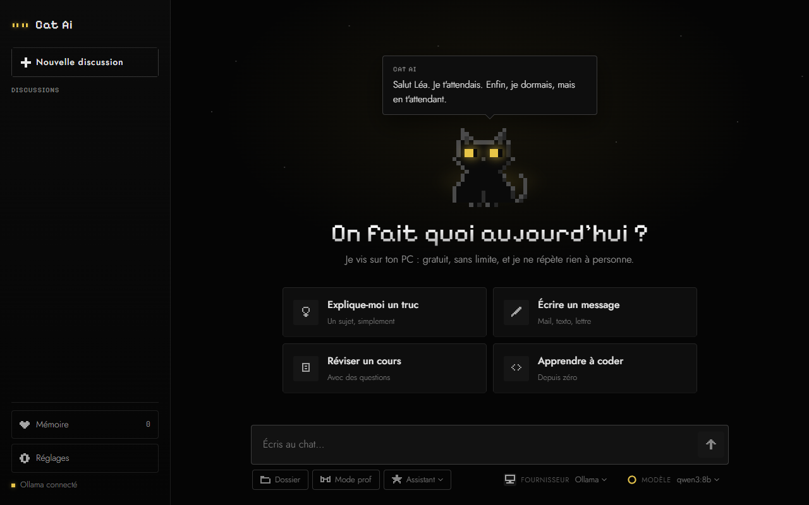
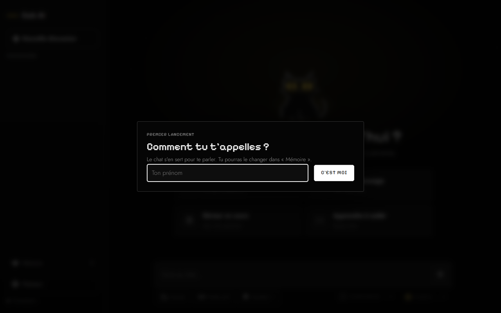
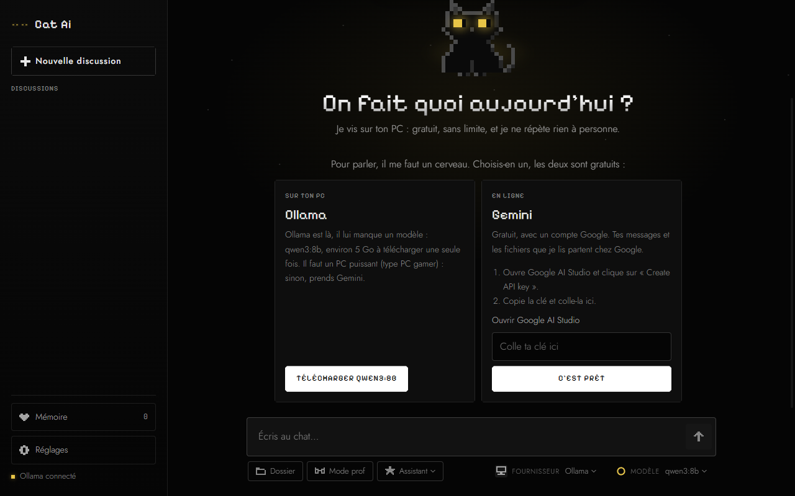
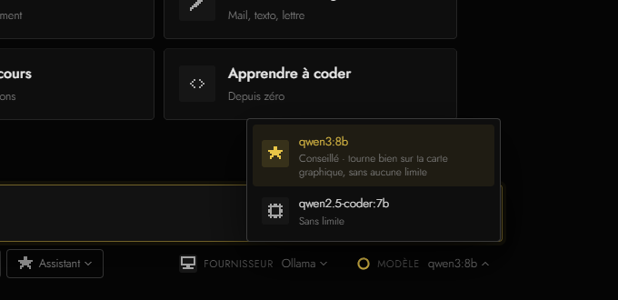
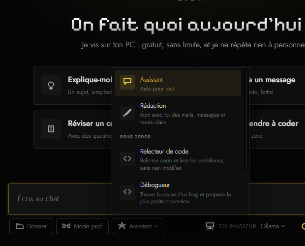
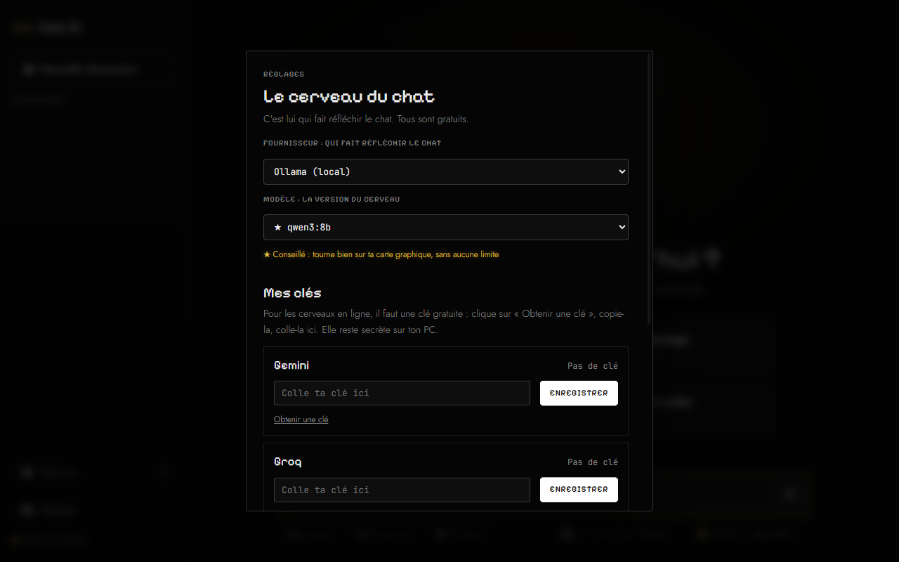

# Cat Ai

Un chat noir en pixel art qui vit sur ton PC et t'aide pour tout : expliquer un sujet, écrire un message, réviser, apprendre à coder. Il sait aussi lire ton code et le modifier, toujours après ton accord.

**100 % gratuit** : il tourne avec [Ollama](https://ollama.com) sur ton PC, ou avec l'offre gratuite d'un fournisseur en ligne (Gemini, Groq, OpenRouter). Aucun modèle payant ne peut être utilisé.



## Tuto : prêt en 3 étapes

### 1. Télécharger

Va dans les [Releases](https://github.com/tom-legros/Cat.ai/releases/latest) et prends le fichier de ton système :

- **Windows** : `Cat-Ai-1.0.0-installateur.exe`
- **Linux** : `Cat-Ai-1.0.0.AppImage`

### 2. Installer

- **Windows** : double-clique sur l'installateur. L'app n'est pas signée (un certificat coûte cher), donc Windows affiche « Windows a protégé votre ordinateur » : clique sur **Informations complémentaires**, puis **Exécuter quand même**. Pas besoin d'être administrateur.
- **Linux** : `chmod +x Cat-Ai-1.0.0.AppImage && ./Cat-Ai-1.0.0.AppImage` (sur Arch, il peut falloir `fuse2`).

### 3. Premier lancement

Le chat te demande ton prénom :



Puis il te propose deux façons gratuites de le faire parler :



| | Ollama | Gemini |
| --- | --- | --- |
| Pour qui | Les PC puissants (type PC gamer récent). Sur un PC portable classique, il sera très lent | Tout le monde, même sur un petit PC |
| Comment | Clique sur « Télécharger » (5 Go, une seule fois) | Crée une [clé gratuite](https://aistudio.google.com/apikey), colle-la, « C'est prêt » |
| Tes données | Ne sortent pas de ton PC | Partent chez Google |

C'est tout : pose ta question en bas, ou clique sur une suggestion.

## Sous la barre de saisie

Tout se règle d'un clic, sans fouiller dans les menus :

- **Dossier** : ouvre un dossier pour que le chat lise son contenu.
- **Mode prof** : il t'aide à trouver par toi-même, sans donner la réponse.
- **Rôle** : la mission du chat (Assistant, Rédaction, ou ceux pour coder). « Créer un rôle » pour inventer le tien : Coach de révisions, Cuisinier…
- **Fournisseur** et **Modèle** : qui fait réfléchir le chat, et quelle version. Chaque choix a un petit conseil, et le rond montre ce qu'il reste du quota gratuit du jour.





Les clés gratuites (Gemini, Groq, OpenRouter) se collent dans **Réglages**, en bas à gauche, avec un lien « Obtenir une clé » pour chacune.



## Ce qu'il sait faire

- **Lire ton projet** : il ouvre un dossier, lit et cherche dans le code, et répond à partir du vrai code.
- **Modifier des fichiers** : chaque modification s'affiche avant / après, et rien n'est écrit sans ton accord.
- **Pour tout le monde** : il explique, aide à écrire, fait réviser, apprend à coder depuis zéro.
- **Mode prof** : il explique et pose des questions, mais c'est toi qui trouves.
- **Rôles** : Rédaction, ceux pour coder (relecteur, débogueur, README), et les tiens.
- **Un vrai chat** : il cligne des yeux, suit ta souris, s'endort quand tu ne fais rien et a toujours une réplique selon l'heure.
- **Mémoire** : il retient ce que tu lui dis d'une discussion à l'autre, et tu peux tout modifier.
- **Sécurité** : un `.env` ou une clé privée n'est jamais lu sans ton accord, les clés API sont chiffrées par le système, et le chat ne sort jamais du dossier ouvert.

## Lancer depuis le code

Il faut [Node.js](https://nodejs.org).

```bash
npm install
npm start
```

| Commande | Rôle |
| --- | --- |
| `npm test` | Lance les tests (`node --test`, sans Electron) |
| `npm run installateur` | Crée l'installateur Windows dans `dist/` |
| `npm run installateur:linux` | Crée l'AppImage (à lancer depuis Linux ou WSL) |

Le code est séparé en deux : `main.js` et `principal/` pour le processus principal (fichiers, modèles, garde-fous), `renderer.js` et `interface/` pour la fenêtre. Les données (discussions, mémoire, clés chiffrées) sont dans `%APPDATA%\assistant-ia` sur Windows et `~/.config/assistant-ia` sur Linux.

## Crédits

- [Electron](https://github.com/electron/electron), [marked](https://github.com/markedjs/marked), [DOMPurify](https://github.com/cure53/DOMPurify), [highlight.js](https://github.com/highlightjs/highlight.js) et [jsdiff](https://github.com/kpdecker/jsdiff).
- [Ollama](https://github.com/ollama/ollama) et les modèles [Qwen](https://github.com/QwenLM/Qwen3) (Apache-2.0).
- Polices sous SIL Open Font License : [Pixelify Sans](https://github.com/eifetx/Pixelify-Sans), [Jost](https://github.com/indestructible-type/Jost), [Marcellus](https://fonts.google.com/specimen/Marcellus), [JetBrains Mono](https://github.com/JetBrains/JetBrainsMono).
- Le chat noir et sa DA viennent de mon portfolio. Application développée avec l'aide de Claude (Anthropic) via Claude Code.

## Licence

[MIT](LICENSE)
