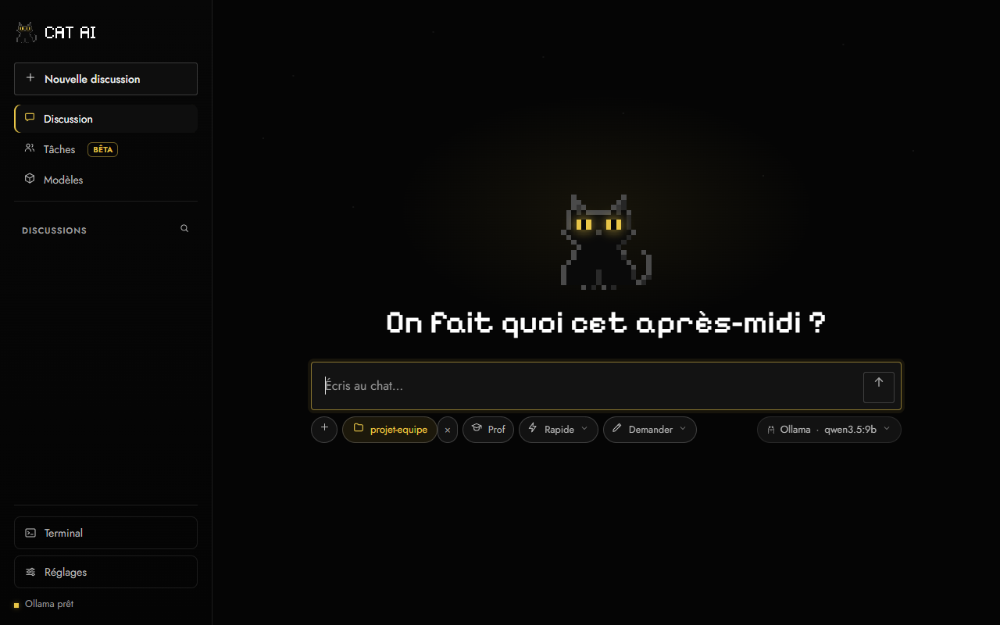

# Cat Ai

[English](README.en.md)

Un chat noir en pixel art qui vit sur ton PC et t'aide pour tout : expliquer un sujet, écrire un message, réviser, apprendre à coder. Il lit aussi ton code et le modifie, toujours après ton accord.

**100 % gratuit** : il tourne avec [Ollama](https://ollama.com) sur ton PC, ou avec l'offre gratuite de Gemini, Groq ou OpenRouter. Aucun modèle payant ne peut être utilisé.

## Installer

Télécharge le fichier de ton système dans la [dernière release](https://github.com/tom-legros/Cat.ai/releases/latest) :

- **Windows** : `Cat-Ai-x.y.z-installateur.exe`, puis double-clic. L'app n'est pas encore signée : si Windows affiche « Windows a protégé votre ordinateur », clique sur **Informations complémentaires**, puis **Exécuter quand même**. Pas besoin d'être administrateur.
- **Linux** : `Cat-Ai-x.y.z.AppImage`. Range-le dans un dossier où il restera (par exemple `~/Applications`), puis `chmod +x Cat-Ai-*.AppImage` et lance-le (sur Arch, il peut falloir `fuse2`). Au premier lancement, Cat Ai propose de s'ajouter au menu des applications.

Les mises à jour arrivent toutes seules : l'app te prévient et s'installe en un clic.

## Premier lancement

Le chat te demande ton prénom, puis te propose deux façons gratuites de le faire parler :

| | Ollama | Gemini |
| --- | --- | --- |
| Pour qui | Les PC puissants (type PC gamer récent) | Tout le monde, même un petit PC |
| Comment | « Télécharger » (5 Go, une seule fois) | Une [clé gratuite](https://aistudio.google.com/apikey) à coller |
| Tes données | Restent sur ton PC | Partent chez Google |

## Ce qu'il sait faire

- **Expliquer, écrire, réviser** : cours, messages, QCM, et un **mode prof** qui t'aide à trouver par toi-même.
- **Lire ton projet** : ouvre un dossier, il répond à partir du vrai code.
- **Modifier des fichiers** : chaque changement s'affiche avant / après et attend ton accord.
- **Chercher sur internet** : il lit la doc (ArchWiki, manuels…) et donne ses sources.
- **Se souvenir** : il retient ce que tu lui dis, et tu peux tout modifier.
- **Dans le terminal** : la commande `catai`, le même chat sans fenêtre.
- **Tâches de fond** *(en test)* : il travaille sur ton projet pendant que tu fais autre chose. À activer dans Réglages › Apparence › Fonctions expérimentales.

## Tes données

Les clés API sont chiffrées par le système, un `.env` ou une clé privée n'est jamais lu sans ton accord, et le chat ne sort pas du dossier ouvert. La seule chose que l'app fait seule sur internet : demander à GitHub s'il existe une nouvelle version.

## Pour les développeurs

Lancer depuis le code, tests, installateurs : [docs/developpement.md](docs/developpement.md).

## Crédits

[Electron](https://github.com/electron/electron), [marked](https://github.com/markedjs/marked), [DOMPurify](https://github.com/cure53/DOMPurify), [highlight.js](https://github.com/highlightjs/highlight.js), [jsdiff](https://github.com/kpdecker/jsdiff), [Ollama](https://github.com/ollama/ollama) et les modèles [Qwen](https://github.com/QwenLM/Qwen3). Polices (SIL OFL) : [Pixelify Sans](https://github.com/eifetx/Pixelify-Sans), [Jost](https://github.com/indestructible-type/Jost), [Marcellus](https://fonts.google.com/specimen/Marcellus), [JetBrains Mono](https://github.com/JetBrains/JetBrainsMono). Le chat noir vient de mon portfolio ; l'app est développée avec l'aide de Claude (Anthropic).

## Licence

[MIT](LICENSE)
