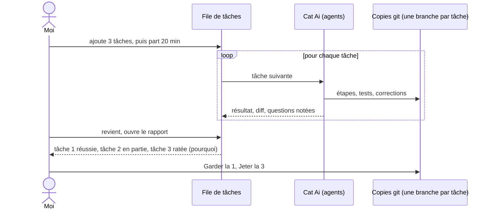
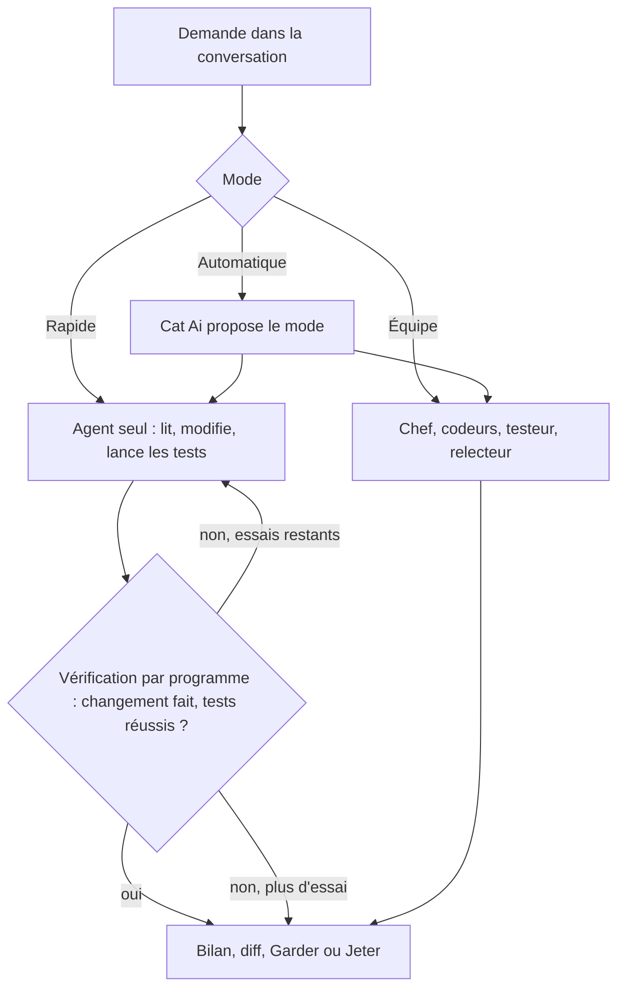
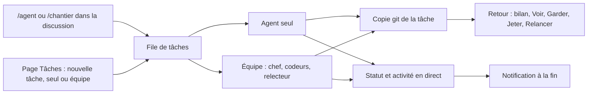
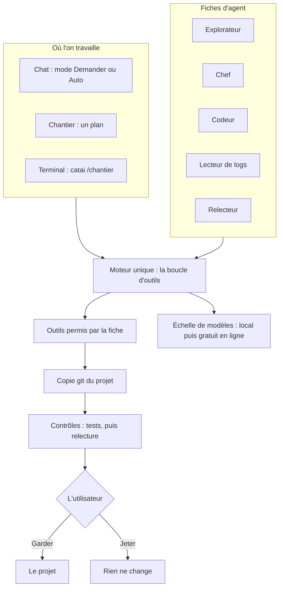
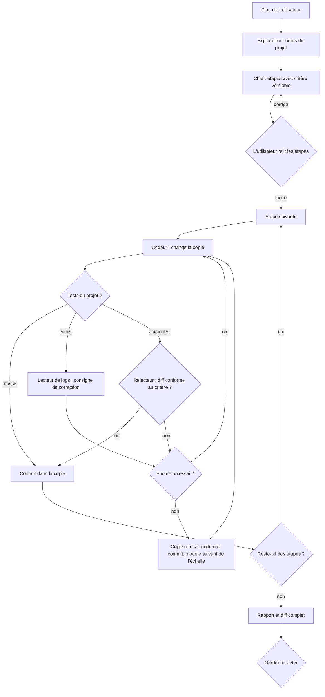
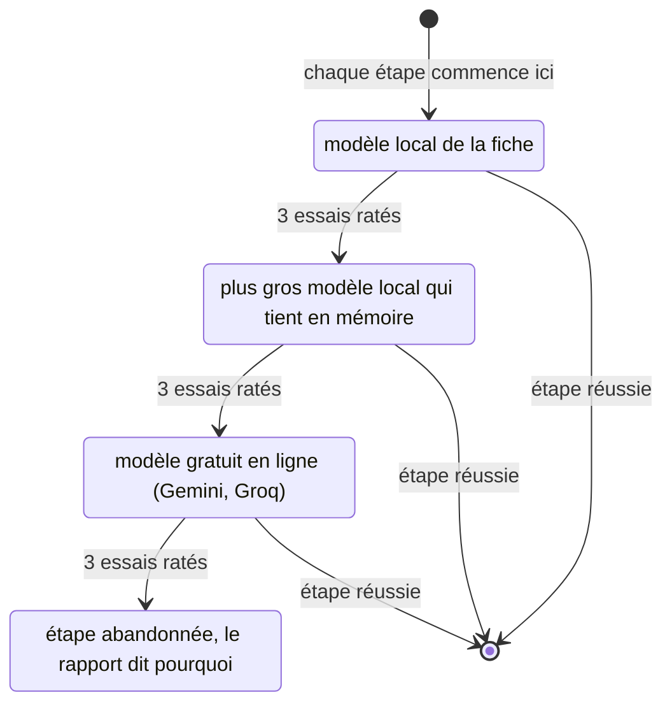

# Conception du système d'agents de Cat Ai (2.0)

## Le but : des tâches de fond

On donne du travail à Cat Ai, on s'en va (20 minutes, une heure de cours, une nuit), et en revenant on trouve un
résultat propre à regarder : ce qui a été fait, le diff, les tests, les questions, et un bouton Garder ou Jeter.

Tout le reste de cette conception en découle :

- **personne ne surveille** : un agent ne doit jamais rester bloqué sur une question ou une fenêtre ;
- **une erreur ne gâche pas le reste** : une tâche ratée n'empêche pas les suivantes, et une étape ratée n'arrête pas
  une tâche si la suite ne dépend pas d'elle ;
- **ce qui compte, c'est ce qu'on retrouve** : le rapport de retour est l'écran le plus important.

### Comment ça se passe

1. **Avant de partir**, on ajoute des tâches à une file : « corrige le bug du menu », « ajoute les tests de la page
   Modèles », « traduis le README ». Chaque tâche vise un projet (un dossier git) ; on peut fixer un budget (temps,
   essais) ou garder celui par défaut.
2. **Pendant l'absence**, Cat Ai les fait une par une, chacune sur **sa propre branche** dans une copie du projet. Le PC
   ne se met pas en veille. Quand une tâche a besoin d'une décision, l'agent prend l'option la plus prudente, note la
   question dans le rapport et continue.
3. **Au retour**, l'écran des tâches montre, pour chacune : réussie, en partie ou ratée ; le résumé ; le diff ; les
   tests ; les questions. On garde ou on jette tâche par tâche (une fusion dans le projet, comme le chantier aujourd'hui).



### Ce qui change par rapport au chantier d'aujourd'hui

| Aujourd'hui | Tâches de fond |
|---|---|
| un plan à la fois | une file de tâches, chacune sur sa branche |
| s'arrête à la première étape ratée | note l'échec, continue avec ce qui n'en dépend pas, puis la tâche suivante |
| peut ouvrir une fenêtre et attendre | ne demande jamais rien pendant l'absence : questions dans le rapport |
| si le chef ne découpe pas, rien ne se fait | sans découpage, la tâche est tentée en une seule étape, puis par un plus gros modèle |
| rapport en texte à la fin | écran de retour : statut, diff, tests et questions par tâche, Garder / Jeter |

Plus tard, la même file tourne sur le homelab : le PC peut rester éteint.

## La décision : un agent seul d'abord, l'équipe pour les gros chantiers

| Mode | Fonctionnement | Quand |
|---|---|---|
| **Rapide** (par défaut) | un **agent seul**, polyvalent, fait la mission de A à Z | la grande majorité des tâches |
| **Équipe** | chef, codeurs, testeur, lecteur de logs, relecteurs (le chantier actuel) | les gros chantiers en plusieurs parties |
| **Automatique** | Cat Ai propose le mode adapté, avec confirmation si besoin | quand on ne sait pas |

Tout part de la conversation : on explique le problème, Cat Ai récupère le contexte du projet et lance une mission
(`/agent`, `/chantier` ou en langage naturel). On suit l'avancement, on regarde les modifications avant de les garder,
et on retrouve un bilan à la fin.

**La priorité est de rendre l'agent seul autonome et fiable**, en gardant l'infrastructure des équipes. Le banc d'essai
l'a montré : avec un petit modèle, la plupart des échecs venaient des échanges entre agents (un chef qui découpe mal,
un relecteur qui refuse à tort), pas du code. Un agent seul évite ces malentendus et consomme moins de tokens.

### L'agent seul

1. Il lit la demande et les fichiers concernés, puis fait les changements dans une copie git du projet.
2. Il lance lui-même les tests du projet, et corrige.
3. Un programme vérifie ensuite : a-t-il vraiment changé quelque chose ? les tests passent-ils ? Sinon, il recommence
   avec la raison, dans la limite de ses essais.
4. Il ne pose jamais de question pendant une tâche de fond : il prend le sens le plus raisonnable et le dit dans son bilan.
5. Il rend un rapport : ce qui a été changé, les tests, ce qui reste douteux. On garde ou on jette.

Il est mesuré avec le même banc d'essai que l'équipe (`node outils/banc-agents.cjs <modèle> seul`), sur les mêmes
projets et les mêmes tests cachés.



## Dans l'app : la page Tâches

L'ancienne page Agents (l'arbre de l'équipe) disparaît. L'app gagne une page **Tâches**, pensée pour les tâches de fond :

- **Lancer** : dans la discussion, `/agent ce qu'il faut faire` (sur le dossier ouvert, avec le modèle choisi dans le
  chat) ; ou dans la page Tâches, un champ « Nouvelle tâche ». On peut en ajouter plusieurs : elles attendent leur tour.
- **Suivre** : chaque tâche a un statut (en attente, en cours, réussie, à vérifier, en partie, ratée, interrompue) ; celle
  en cours montre ce que fait l'agent (« essai 1/3 · lit src/calcul.js »). Un badge sur l'entrée Tâches compte celles
  qui tournent. Une notification arrive quand une tâche se termine.
- **Revenir** : chaque tâche terminée montre son bilan, ses fichiers changés, ses tests et ses doutes, avec **Voir**
  (le diff, la même fenêtre que le mode Auto), **Garder** (les changements vont dans le projet) et **Jeter**.
  Une tâche ratée ou interrompue peut être relancée.

Côté programme :

- `principal/taches.js` : la file (une tâche à la fois), enregistrée dans les données de l'app ; au redémarrage, une
  tâche qui était en cours devient « interrompue ».
- L'agent seul (`principal/mission.js`) fait chaque tâche dans sa copie git (la même que le mode Auto : Voir, Garder et
  Jeter existent déjà) ; avec Ollama, chaque appel passe par la file d'Ollama, pour que le chat reste utilisable.
- Le PC ne se met pas en veille tant que la file travaille.
- Le mode Équipe passe par la même file : `/chantier ce qu'il faut faire` dans la discussion, ou « Équipe » à côté du
  champ de la page Tâches. Le chantier (chef, codeurs, relecteur) travaille dans sa copie git ; à la fin, les tests du
  projet sont relancés sur le travail entier, et Voir, Garder, Jeter marchent comme pour l'agent seul.
- Une tâche ne tourne jamais sans fin : 45 min au plus pour l'agent seul, 2 h pour l'équipe. Arrêtée avec du travail
  dans sa copie, elle passe « en partie » (on peut le voir et le garder) ; une copie sans aucun changement est retirée
  tout de suite, avec sa branche.
- Plus tard : le mode Automatique (Cat Ai choisit seul ou équipe), et la file sur le homelab.



## Le constat

Cat Ai a déjà trois façons de faire travailler un modèle sur un projet :

- **le chat** avec un dossier ouvert : l'agent lit et modifie, avec accord (mode Demander) ou dans une copie git (mode Auto) ;
- **le chantier** : un chef découpe un plan en étapes, des codeurs les font dans une copie git, des contrôles (tests, relecture) acceptent ou refusent chaque étape ;
- **l'équipe** de la page Agents : un arbre (chef, codeurs, testeur, lecteur de logs, relecteur) que l'on compose.

Elles partagent la même boucle d'outils (`principal/agent.js`), mais chaque rôle est codé à part (consignes en dur, outils choisis dans le code). Ajouter un rôle, changer un modèle ou mesurer ce qui marche demande de toucher au code.

Et la contrainte principale ne change pas : **des modèles locaux modestes** (8 192 tokens de contexte, 2 à 9 milliards de paramètres), parfois sur un PC sans carte graphique. Un bon système d'agents pour Cat Ai n'est pas celui qui ressemble le plus à une équipe humaine, c'est celui qui **réussit le plus souvent avec un petit modèle**.

## Les principes

1. **Un seul moteur, des fiches.** Un agent n'est pas du code : c'est une fiche (rôle, consignes, outils permis, modèle, budget, format de sortie). Le moteur est la boucle qui existe déjà.
2. **Des étapes petites et vérifiables.** Un petit modèle réussit une étape qui tient dans un fichier ou deux, pas un plan entier. Le chef découpe jusqu'à ce que chaque étape ait un critère de réussite vérifiable.
3. **Les programmes vérifient, les modèles proposent.** Les tests, le lint, la compilation, `git diff` décident en premier. Un modèle relecteur n'intervient que là où aucun programme ne peut juger.
4. **Monter en gamme seulement si nécessaire.** Chaque étape commence avec le modèle le moins cher (local). Après un échec vérifié, elle passe au modèle suivant de l'échelle (local plus gros, puis gratuit en ligne). Jamais de modèle payant.
5. **Rien ne touche le projet sans accord.** Tout se passe dans une copie git ; l'utilisateur garde ou jette à la fin (déjà en place).
6. **Tout se mesure.** Chaque fiche et chaque modèle ont un taux de réussite, mesuré sur un banc d'essai, comme le benchmark des modèles.

## L'architecture



## La fiche d'agent

```json
{
  "id": "codeur",
  "role": "Écrire le code d'une étape",
  "consignes": "…",
  "outils": ["lister_fichiers", "lire_fichier", "chercher", "remplacer_texte", "ecrire_fichier"],
  "permissions": { "ecrire": "copie", "commandes": [] },
  "echelle": [
    { "fournisseur": "ollama", "modele": "qwen3.5:9b" },
    { "fournisseur": "gemini", "modele": "gemini-flash" }
  ],
  "budget": { "tours": 12, "minutes": 10 },
  "entree": ["etape", "fichiers_cites", "notes_projet"],
  "sortie": "diff",
  "controles": ["tests", "relecture"]
}
```

- **outils** : une liste fermée. Moins d'outils, c'est moins de tokens et moins d'erreurs pour un petit modèle.
- **permissions.commandes** : seulement des commandes d'une liste sûre (tests, lint, build), jamais une commande libre écrite par le modèle.
- **echelle** : l'ordre de montée en gamme (principe 4).
- **sortie** : `diff` (le moteur regarde la copie git), `json` (avec un schéma vérifié, pour le chef et le relecteur) ou `texte`.

Les fiches de base (chef, codeur, testeur, lecteur de logs, relecteur, explorateur) sont livrées avec l'app. Les équipes de la page Agents deviennent des arbres de fiches. Une fiche modifiée par l'utilisateur est gardée à part et peut être remise par défaut.

## Les rôles

| Rôle | Ce qu'il fait | Modèle | Sortie |
|---|---|---|---|
| **Explorateur** (nouveau) | une fois par projet : type de projet, commande de tests, conventions, fichiers importants | petit | `notes_projet` |
| **Chef** | découpe le plan en étapes avec un critère vérifiable chacune | le meilleur disponible | JSON |
| **Codeur** | fait une étape dans la copie | échelle local → en ligne | diff |
| **Testeur** | lance la commande de tests trouvée par l'explorateur | aucun (programme) | réussite / sortie |
| **Lecteur de logs** | résume un échec de tests en une consigne de correction | petit | texte court |
| **Relecteur** | compare le diff au critère de l'étape, seulement s'il n'y a pas de test | moyen | JSON `{ok, remarque}` |

### L'explorateur et les notes de projet

C'est ce qui manque le plus aujourd'hui. Avant le premier chantier, l'explorateur écrit `.catai/notes.md` dans le projet (avec accord) :

- le type de projet et la commande de tests : `npm test`, `vendor/bin/codecept run`, `vendor/bin/phpunit`, `pytest`, `godot --headless`… détectés à partir de `package.json`, `composer.json`, `pyproject.toml`, `project.godot`, puis confirmés par un vrai lancement ;
- les dossiers importants et ceux à ignorer ;
- les conventions vues dans le code (langue des noms, style, framework).

Ces notes (800 caractères au plus) sont données à chaque agent à la place d'une longue liste de fichiers : moins de tokens, de meilleures décisions. L'utilisateur peut les corriger à la main.

## Le déroulement d'un chantier

1. **Préparer** : l'explorateur fait ou met à jour les notes ; le chef découpe le plan. L'utilisateur voit les étapes et peut les modifier avant de lancer (déjà possible).
2. **Pour chaque étape** :
   1. le codeur travaille dans la copie, avec l'étape, les notes et les fichiers cités ;
   2. le testeur lance les tests ; en cas d'échec, le lecteur de logs écrit une consigne et le codeur réessaie (3 essais) ;
   3. sans test applicable, le relecteur juge le diff contre le critère ;
   4. après les essais ratés, l'étape monte d'un cran dans l'échelle des modèles ;
   5. une étape réussie devient un commit dans la copie.
3. **Finir** : un rapport (étapes, essais, modèles utilisés, temps) ; l'utilisateur voit le diff complet, garde ou jette.



### L'échelle des modèles



L'état est écrit après chaque étape : un chantier arrêté (PC éteint, Ctrl+C) reprend là où il en était (en partie en place).

## Ce que l'interface montre

- La page Agents devient un **tableau de bord** : le chantier en cours (arbre avec l'agent qui a la main, l'étape, le modèle, les essais), puis l'historique des chantiers avec leur rapport.
- Chaque étape réussie montre son petit diff ; à la fin, le diff complet avec **Garder** / **Jeter**.
- Les fiches se modifient dans un panneau simple (modèle, échelle, outils cochés), pas en JSON.

## Le banc d'essai des agents

Sans mesure, on ne sait pas si un changement de consigne aide ou nuit. Le banc d'essai :

- une dizaine de petits dépôts de test dans `tests/agents/` (JavaScript, PHP, Python), chacun avec un plan court et des **tests cachés** que le codeur ne voit pas ;
- une commande lance tous les chantiers avec une configuration donnée (fiches + modèles) et note : étapes réussies, essais, temps, tokens, montées en gamme ;
- les résultats s'ajoutent à un tableau, comme `benchmark.md`.

C'est l'outil qui permet de choisir les consignes et les modèles par défaut avec des chiffres.

## Ce qui n'est pas prévu (et pourquoi)

- **Des agents qui discutent librement entre eux** : avec 8 192 tokens, une conversation entre agents consomme le contexte et dérive. Les agents se passent des objets courts (étape, diff, consigne de correction), pas des messages.
- **Du parallélisme d'écriture** : deux codeurs dans la même copie se marchent dessus, et Ollama ne génère qu'une réponse à la fois sur un PC. Le parallélisme est réservé aux modèles en ligne et aux lectures.
- **Des commandes libres** : le modèle n'écrit jamais une commande à exécuter ; il choisit dans une liste sûre.

## Ce qu'un deuxième avis a changé

La conception a été relue par un autre modèle (Gemini). Trois remarques sont retenues :

- **Le banc d'essai passe en premier.** Changer les fiches ou ajouter l'explorateur sans mesure, c'est optimiser à l'aveugle : on mesure d'abord le chantier actuel, puis chaque changement.
- **Des notes de projet courtes.** Une page de conventions mange le contexte d'un petit modèle. Les notes se limitent aux commandes (tests, build), aux dossiers importants et à ignorer : 800 caractères au plus.
- **Des garde-fous globaux.** Avant chaque montée en gamme, la copie revient au dernier commit valide (le chantier le fait déjà au 3e essai, il faut le garantir aussi au changement de modèle). Et un plafond de temps et de tours pour tout le chantier, pas seulement par étape.

Le chef reste le point fragile : un découpage raté fait échouer tout le reste. D'où le meilleur modèle disponible pour lui, un JSON vérifié (le chantier le valide déjà), des étapes que l'utilisateur peut relire quand il est là, et, pour les tâches de fond, un repli : sans découpage, la tâche est tentée en une seule étape. Le banc d'essai l'a confirmé dès la première mesure (le chef de qwen3.5:9b n'a pas su découper le projet « renommer »).

## Le plan de travail

1. **Banc d'essai minimal** (fait) : 4 petits projets avec tests cachés dans `tests/agents/`, `node outils/banc-agents.cjs <modèle>`, première mesure du chantier actuel.
2. **Un chantier qui ne s'arrête plus** : repli quand le chef ne découpe pas (une seule étape), une étape ratée n'arrête que ce qui en dépend, un plafond global de temps et d'essais. Mesure avec le banc.
3. **Tâches de fond** : une file de tâches (une branche chacune), aucune fenêtre pendant l'absence (décision prudente + question notée), PC qui ne dort pas, rapport de retour par tâche avec Garder / Jeter.
4. **Fiches** : `principal/fiches.js` (fiches de base, validation, fusion avec celles de l'utilisateur) ; le chantier lit les fiches au lieu de consignes en dur. Mesure avec le banc.
5. **Explorateur ciblé** : type de projet et commande de tests (npm, Codeception, PHPUnit, pytest, Godot), `.catai/notes.md` court, avec accord. Mesure avec le banc.
6. **Échelle de modèles** : copie remise au dernier commit valide, puis modèle suivant ; le rapport dit quel modèle a fait quoi.
7. **Page Agents** : l'écran des tâches (file, en cours, retour), édition simple des fiches, remise de `PAGE_AGENTS = true`.
8. Plus tard : la même file sur le homelab (PC éteint), lancée aussi depuis le terminal (`/tache`).
