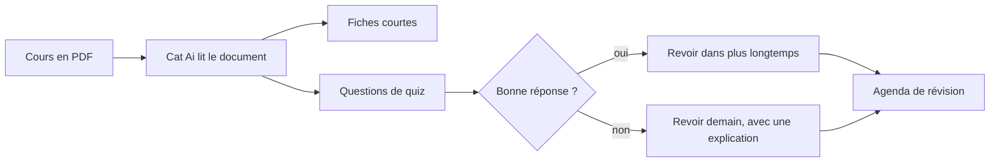
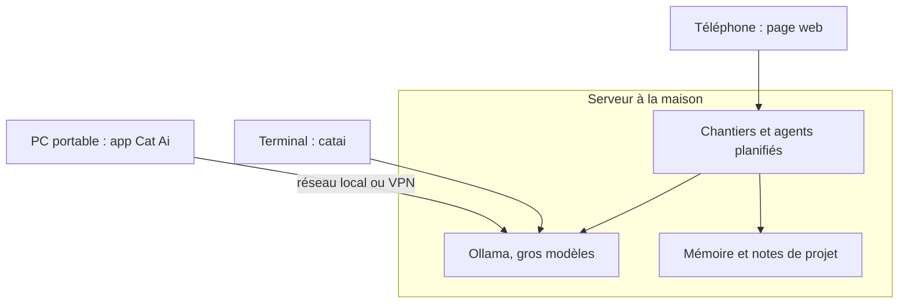
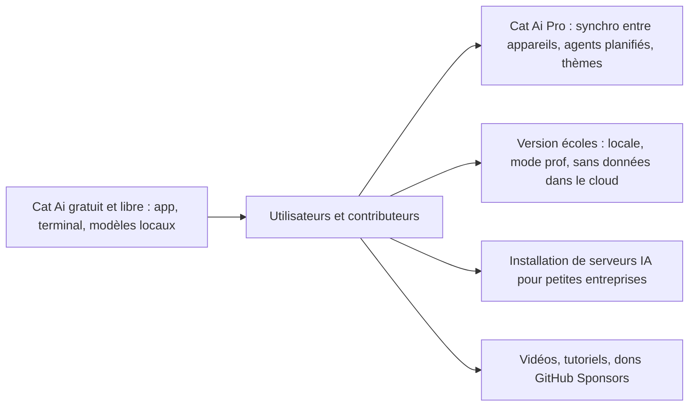

# Idées pour après la 2.0

Des pistes, pas des promesses : à trier et mesurer avant de se lancer.

## Améliorer Cat Ai

### Mode révision pour les cours

À partir des PDF et des notes de cours : fiches, quiz, et répétition espacée (on revoit une notion juste avant de l'oublier). Tout en local, avec le mode prof pour ne pas donner les réponses toutes faites.

### Homelab allumé en permanence

Un serveur à la maison fait tourner Ollama et les agents ; le PC portable, le terminal et le téléphone s'y connectent. Les petits PC profitent des gros modèles, les chantiers tournent la nuit.

### Les autres pistes

- **La voix** : dictée et lecture des réponses en local (Whisper pour écouter, Piper pour parler).
- **Une mémoire de projet partagée** entre l'app, le terminal et les agents (les notes `.catai/notes.md` de la conception des agents).
- **Des agents planifiés** : chaque soir, relancer les tests d'un projet et laisser un résumé au matin.
- **Une extension VS Code** branchée sur le même moteur que l'app et le terminal.
- **Installer la commande `catai` depuis l'app** (Windows et Linux), sans `npm link`.

## Gagner de l'argent avec Cat Ai

Le principe : **le cœur reste gratuit et libre**, ce qui est payant tourne autour.

- **Cat Ai Pro** à quelques euros par mois : synchronisation des discussions entre appareils, agents planifiés, thèmes. L'app de base ne perd rien.
- **Une version pour les écoles** : une IA qui tourne sur place, sans données envoyées dans le cloud (un vrai argument pour le RGPD), avec le mode prof.
- **Installer des serveurs IA** pour de petites entreprises qui veulent garder leurs données chez elles.
- **Le contenu** : vidéos et tutoriels sur la construction de Cat Ai, dons via GitHub Sponsors.
